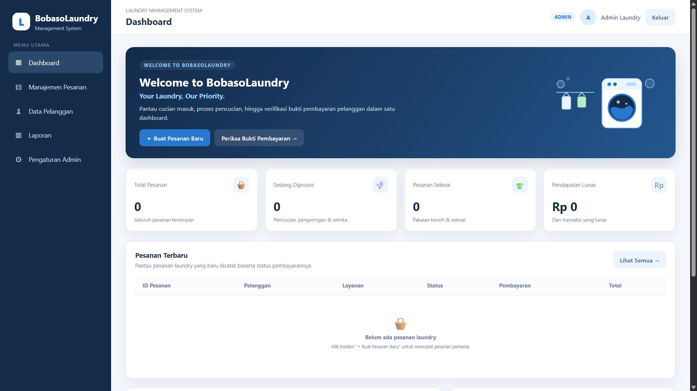
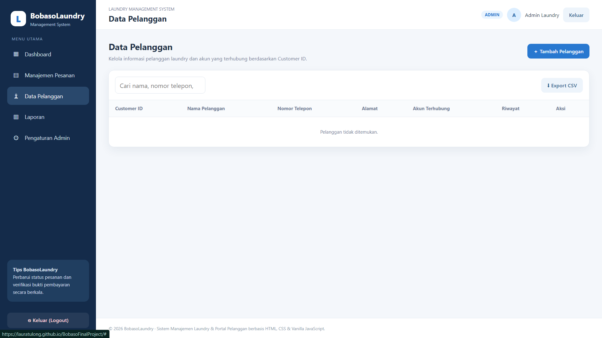
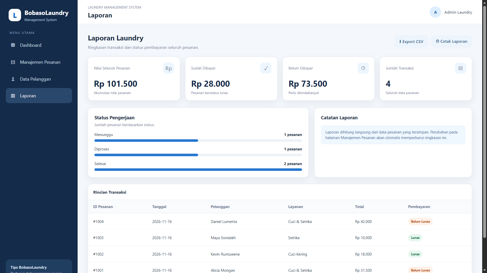
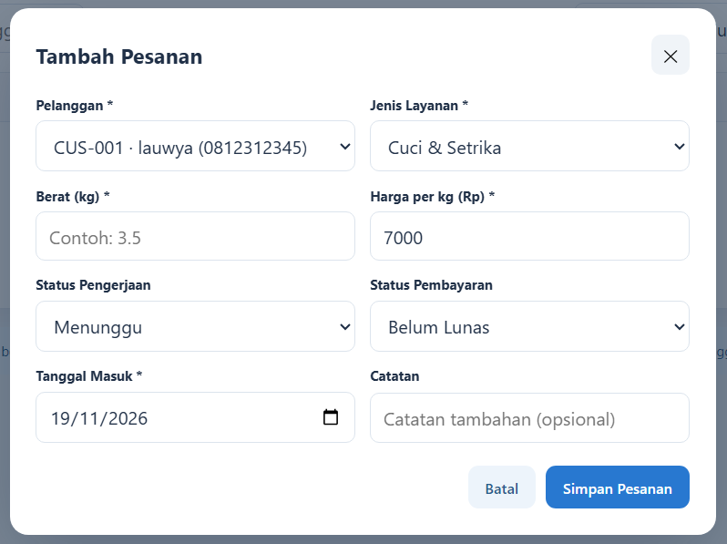

# BobasoLaundry — Sistem Manajemen Laundry & Portal Pelanggan

Aplikasi web interaktif untuk mengelola operasional pesanan laundry oleh **Admin** sekaligus portal mandiri bagi **Customer** untuk mendaftarkan akun (*Create Account*), memantau progres cucian (*Laundry Tracking*), melihat tagihan, dan mengunggah bukti pembayaran (*Upload Payment Proof*) untuk diverifikasi Admin. Dibuat sebagai **Final Project Web Design: Interactive Web Application Development** menggunakan **HTML5, CSS3, dan Vanilla JavaScript** (tanpa framework).

> **Anggota kelompok:** Korompis, Marselino Jibryl (105012510061)
> Mongan,Blessi Evangely (105012510044)
> Tulong,Laura Kathleen Pathfinderly Tabita Jr (105022428001)
> Kaeng, Petra Putra Anugrah (105032410023)
> Yong, Herul Sabbathface (105022510015)
> **Mata kuliah / dosen:** Web Design (sir Regi Najoan)

---

## Daftar Isi

1. [Deskripsi](#deskripsi)
2. [Fitur Utama](#fitur-utama)
3. [Informasi Akun Pengujian Dosen](#informasi-akun-pengujian-dosen)
4. [Screenshot](#screenshot)
5. [Teknologi](#teknologi)
6. [Struktur Folder](#struktur-folder)
7. [Cara Menjalankan](#cara-menjalankan)
8. [Alur Penggunaan & Pengujian](#alur-penggunaan--pengujian)
9. [Penjelasan Struktur Data & Implementasi JavaScript](#penjelasan-struktur-data--implementasi-javascript)
10. [Aturan Validasi & Proteksi Role](#aturan-validasi--proteksi-role)
11. [Pemenuhan Ketentuan Project](#pemenuhan-ketentuan-project)

---

## Deskripsi

Banyak usaha laundry kecil masih mencatat pesanan dan memeriksa pembayaran secara manual di buku nota. Akibatnya status pengerjaan sulit dipantau baik oleh pengelola maupun pelanggan, bukti transfer tercecer, dan rekap pendapatan harus dihitung sendiri.

**BobasoLaundry** menyelesaikan masalah tersebut dengan satu aplikasi web terintegrasi yang menyediakan dua peran pengguna (**Admin** dan **Customer**):

- **Customer** dapat membuat akun baru melalui fitur **Create Account**, login ke dashboard pelanggan yang dilengkapi sapaan dinamis (`"Hello, [Customer Name]!"`), melihat statistik pesanan pribadinya, melacak progres laundry melalui *timeline* 6 tahap, memilih metode pembayaran (`QRIS` / `Transfer Bank`), serta mengunggah foto bukti pembayaran (`Upload Payment Proof`).
- **Admin** mencatat pesanan beserta tahapan pengerjaan, memeriksa foto bukti pembayaran yang diunggah pelanggan melalui modal **View Payment Proof**, serta melakukan **Verify Payment (Lunas)** atau **Reject Payment (Ditolak)** beserta alasan penolakan.

Seluruh metadata disimpan di **Local Storage** browser (`laundryku_data_v1`) dengan sistem migrasi non-destruktif, sedangkan file gambar bukti pembayaran disimpan di **IndexedDB** (`BobasoLaundryProofDB`) dengan kompresi Canvas otomatis agar penyimpanan tetap ringan dan cepat.

---

## Fitur Utama

### 1. Autentikasi & Registrasi Pelanggan (Create Account)
- **Halaman Login Bersih**: Tanpa panel bocoran akun demo pada UI, dilengkapi pemilih peran **Admin** dan **Customer**.
- **Create Account Customer**: Tautan *"Don't have an account? Create Account"* membuka form registrasi pelanggan (`Full Name`, `Phone Number`, `Address`, `Username`, `Password`, `Confirm Password`).
- **Integrasi Otomatis Tanpa Duplikasi**: Saat pelanggan mendaftar, sistem otomatis membuat atau menghubungkan data pada `db.customers` melalui `customerId` tanpa membuat data pelanggan ganda.
- **Proteksi Navigasi & Role**: Customer hanya dapat mengakses halaman Customer serta hanya dapat melihat pesanan dan bukti pembayaran miliknya sendiri.

### 2. Desain Dashboard Bertema Laundry
- **Welcome Banner**:
  - Banner bertuliskan *"Welcome to BobasoLaundry — Your Laundry, Our Priority."* lengkap dengan ilustrasi SVG mesin cuci, keranjang pakaian, tumpukan handuk bersih, pakaian gantung, dan gelembung sabun.
  - Sapaan dinamis untuk Customer: *"Hello, [Customer Name]! Welcome back to BobasoLaundry."* beserta 3 kartu ringkasan pesanan pelanggan (Total Pesanan, Sedang Diproses, Pesanan Selesai).

### 3. Fitur Customer — Tracking & Upload Payment Proof
| Fitur | Deskripsi |
|---|---|
| **Search & My Orders** | Menampilkan daftar pesanan milik akun pelanggan yang sedang login serta pencarian berdasarkan ID/kode pesanan (`#1`, `BL-0001`) atau nama dengan verifikasi nomor telepon |
| **Laundry Tracking (6 Tahap)** | Progress bar persentase dan *timeline* 6 tahap: `Menunggu` → `Diproses / Dicuci` → `Sedang Dikeringkan` → `Sedang Disetrika` → `Siap Diambil` → `Selesai` |
| **Upload Payment Proof** | Pilihan metode `QRIS` atau `Transfer Bank`, input file gambar (`JPG`, `JPEG`, `PNG`, `WEBP`, maks. 2 MB), preview gambar sebelum dikirim, tombol *Hapus / Ganti File*, dan tombol *Submit Payment Proof* |
| **Status & Alasan Penolakan** | Menampilkan status `Belum Lunas`, `Menunggu Verifikasi`, `Lunas`, atau `Ditolak`. Jika ditolak Admin, alasan penolakan tampil jelas dan pelanggan dapat mengunggah ulang bukti baru |
| **Struk & Riwayat Pembayaran** | Cetak struk bukti pembayaran yang sudah diverifikasi Lunas serta tabel **Riwayat Pembayaran & Pengiriman Bukti** |

### 4. Fitur Admin — Manajemen & Verifikasi Pembayaran
| Tampilan | Fitur |
|---|---|
| **Dashboard** | Welcome banner bertema laundry, 4 kartu statistik (total pesanan, sedang diproses, selesai, pendapatan lunas + jumlah bukti menunggu verifikasi), dan tabel 5 pesanan terbaru |
| **Manajemen Pesanan** | CRUD pesanan, filter status cucian & filter status pembayaran, tombol **View Payment Proof**, tombol aksi cepat **✓ Verify** dan **✕ Reject**, serta **Export CSV** |
| **Modal View Payment Proof** | Menampilkan detail pesanan, metode pembayaran, waktu unggah, foto bukti pembayaran (dengan fitur **Perbesar/Zoom** & **Unduh Bukti**), atau pesan *"No Payment Proof Uploaded"* jika belum ada bukti |
| **Verify & Reject Payment** | Admin dapat mengubah status pembayaran secara langsung, menerima bukti (**Verify Payment** → `Lunas`), atau menolak bukti (**Reject Payment** → `Ditolak` dengan input alasan penolakan wajib) |
| **Data Pelanggan & Laporan** | CRUD pelanggan (menampilkan username akun yang terhubung), laporan pendapatan Lunas vs Belum Lunas, grafik batang 6 tahap status, Export CSV, dan Cetak Laporan |

---

## Informasi Akun Pengujian Dosen

Untuk keperluan pengujian dan presentasi dosen, gunakan kredensial berikut pada halaman Login:

| Role | Username | Password | Keterangan |
|---|---|---|---|
| **Admin** | `admin` | `admin123` | Akses penuh ke Dashboard Admin, CRUD Pesanan & Pelanggan, Verifikasi Pembayaran, Laporan, dan Export CSV |
| **Customer** | *(Buat melalui **Create Account**)* | *(Sesuai registrasi, min. 8 karakter)* | Otomatis terhubung ke `db.customers` dan langsung dapat digunakan login |

---

## Screenshot

> Tambahkan screenshot hasil aplikasi ke folder `screenshots/`, lalu pastikan nama file sesuai dengan tautan di bawah.

| Dashboard | Manajemen Pesanan |
|---|---|
|  |  |

| Data Pelanggan | Laporan |
|---|---|
|  |  |

| Form Pesanan | Tampilan Mobile |
|---|---|
|  |  |

---

## Teknologi

- **HTML5** — semantic HTML (`aside`, `nav`, `header`, `main`, `section`, `article`, `footer`) & SVG inline bertema laundry
- **CSS3** — Flexbox, CSS Grid, variabel CSS (`:root`), media query responsif, `@media print`
- **JavaScript (Vanilla)** — DOM manipulation, event handling, array & objek, `FileReader`, `Canvas` image compression, `Blob` CSV exporter
- **Web Storage & IndexedDB API** — `localStorage` (`laundryku_data_v1`) untuk data terstruktur dan `IndexedDB` (`BobasoLaundryProofDB`) untuk penyimpanan foto bukti pembayaran

---

## Struktur Folder

```
BobasoFinalProject-main/
├── index.html          # Halaman Login, Create Account, Dashboard Admin & Customer, Modal Verifikasi
├── style.css           # Seluruh gaya, palet warna, banner laundry, badge, modal, dan media query
├── app.js              # Registrasi, autentikasi role, IndexedDB bukti bayar, verifikasi Admin, CRUD, CSV
├── screenshots/        # Gambar untuk dokumentasi README
├── PPT WEB DESIGN.pptx # File presentasi project
└── README.md
```

---

## Cara Menjalankan

1. Buka folder project di komputer Anda.
2. Buka `index.html` langsung di browser modern (Chrome, Edge, Firefox, Safari) atau jalankan melalui ekstensi **Live Server** di Visual Studio Code.

---

## Alur Penggunaan & Pengujian

1. **Buat Akun Customer (`Create Account`)**:
   - Pada halaman Login, klik **Create Account** di bagian bawah form.
   - Isi `Full Name`, `Phone Number` (misal `081234567890`), `Address`, `Username` (min. 4 karakter), `Password` (min. 8 karakter), dan `Confirm Password`.
   - Klik **Create Account →**. Sistem menyimpan akun dan membuat data pelanggan baru, lalu mengarahkan kembali ke halaman Login.
2. **Admin Membuat Pesanan**:
   - Login sebagai **Admin** (`admin` / `admin123`).
   - Buka **Manajemen Pesanan** → klik **＋ Tambah Pesanan** → pilih pelanggan yang baru mendaftar, isi layanan dan berat, lalu simpan.
3. **Customer Mengunggah Bukti Pembayaran**:
   - Logout dari Admin, lalu login sebagai **Customer** menggunakan akun yang baru dibuat.
   - Lihat pesanan pada **Customer Dashboard**, pilih metode pembayaran (`QRIS` atau `Transfer Bank`), pilih file gambar (`JPG`/`PNG`/`WEBP`, maks. 2 MB) pada bagian **Upload Payment Proof**, periksa preview gambar, lalu klik **✓ Submit Payment Proof**.
   - Status pembayaran berubah menjadi **Menunggu Verifikasi**.
4. **Admin Memeriksa & Memverifikasi Bukti Pembayaran**:
   - Login kembali sebagai **Admin** → buka **Manajemen Pesanan**.
   - Klik **🧾 View Payment Proof** pada baris pesanan tersebut untuk melihat foto bukti pembayaran.
   - Klik **✓ Verify Payment (Lunas)** untuk menyetujui pembayaran, atau **✕ Reject Payment** dan isi alasan penolakan untuk menolak bukti.
5. **Customer Melihat Hasil Verifikasi**:
   - Login kembali sebagai **Customer**. Jika disetujui, status menjadi **Lunas** dan struk dapat dicetak. Jika ditolak, alasan penolakan ditampilkan dan Customer dapat mengunggah ulang bukti pembayaran.

---

## Penjelasan Struktur Data & Implementasi JavaScript

Data utama disimpan pada Local Storage dengan key `laundryku_data_v1`:

```js
db = {
  customers: [
    { id, name, phone, address }
  ],
  accounts: [
    { id, customerId, username, password, role: "customer" }
  ],
  orders: [
    {
      id, customerId, service, weight, price, status, payment, date, note,
      paymentMethod, paymentProofId, paymentProofName, paymentProofDate,
      paymentStatus, paymentNote, verifiedAt
    }
  ],
  payments: [
    { id, refCode, orderId, customerId, customerName, method, amount, date, verifiedAt, status, note }
  ]
};
```

---

## Aturan Validasi & Proteksi Role

- **Registrasi Customer**: Semua kolom wajib diisi, nama $\ge 2$ karakter, telepon sesuai `/^(\+62|0)[0-9]{8,13}$/`, alamat $\ge 3$ karakter, username $\ge 4$ karakter tanpa spasi & belum terdaftar, password $\ge 8$ karakter, dan confirm password harus cocok.
- **Upload Bukti Pembayaran**: Wajib memilih file, format harus `JPG`, `JPEG`, `PNG`, atau `WEBP`, ukuran maksimal `2 MB`. Customer hanya dapat mengubah status menjadi `Menunggu Verifikasi` (tidak bisa langsung menjadi `Lunas`).
- **Verifikasi Admin**: Hanya Admin yang dapat mengubah status menjadi `Lunas` atau `Ditolak`. Penolakan wajib disertai alasan penolakan.

---

## Pemenuhan Ketentuan Project

| Ketentuan | Implementasi |
|---|---|
| Create Account Customer | Form registrasi lengkap dengan validasi & integrasi otomatis ke `db.customers` |
| Tanpa Panduan Demo di UI Login | Panel akun demo dihapus dari halaman Login; kredensial Admin didokumentasikan di README |
| Desain Bertema Laundry | Welcome banner & empty state dengan ilustrasi SVG mesin cuci, keranjang, handuk, dan pakaian gantung |
| Upload Payment Proof (Customer) | Validasi format & ukuran 2 MB, preview gambar, penyimpanan IndexedDB, status `Menunggu Verifikasi` |
| Payment Verification (Admin) | Modal `View Payment Proof`, zoom/unduh bukti, `Verify Payment (Lunas)`, dan `Reject Payment` dengan alasan |
| Sinkronisasi & Privasi Role | Terhubung melalui `customerId` & `orderId` pada `laundryku_data_v1`; Customer hanya melihat pesanannya sendiri |

| Minimal 4 tampilan | Dashboard, Manajemen Pesanan, Data Pelanggan, Laporan |
| CRUD | Pesanan dan pelanggan |
| Search dan filter | Pencarian pesanan dan pelanggan, filter status pesanan |
| Form validation | HTML5 dan JavaScript |
| Local Storage | `localStorage` dengan format JSON |
| Responsive design | Breakpoint 1000px (tablet) dan 700px (mobile) |
| DOM manipulation dan event handling | Render dinamis dan `addEventListener` |
| Dashboard / summary | Kartu statistik dan halaman Laporan |
| Notifikasi / konfirmasi | Toast, `confirm()`, dan `alert()` |
| UI/UX konsisten | Satu sistem warna dan komponen di seluruh halaman |
| HTML5, CSS3, Vanilla JS | Tanpa framework frontend |

https://lauratulong.github.io/BobasoFinalProject/
---

© 2026 BobasoLaundry · Final Project Web Design
