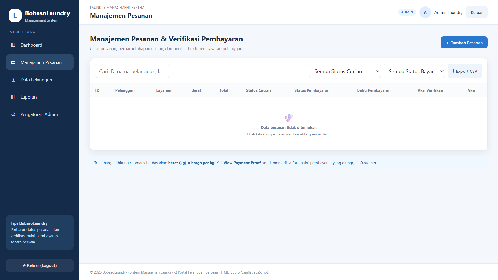
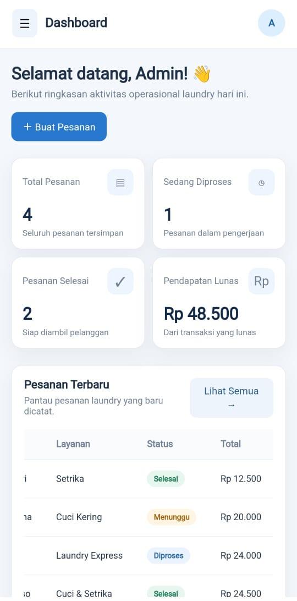

# BobasoLaundry — Sistem Manajemen Laundry & Portal Pelanggan

Aplikasi web interaktif untuk mengelola operasional pesanan laundry oleh **Admin** sekaligus portal mandiri bagi **Customer** untuk mencari pesanan, memantau progres cucian (*Laundry Tracking*), melihat tagihan, dan melakukan simulasi pembayaran online. Dibuat sebagai **Final Project Web Design: Interactive Web Application Development** menggunakan **HTML5, CSS3, dan Vanilla JavaScript** (tanpa framework).

> **Anggota kelompok:** isi nama dan NIM anggota di sini
> **Mata kuliah / dosen:** isi di sini

---

## Daftar Isi

1. [Deskripsi](#deskripsi)
2. [Fitur](#fitur)
3. [Akun Demo Login](#akun-demo-login)
4. [Screenshot](#screenshot)
5. [Teknologi](#teknologi)
6. [Struktur Folder](#struktur-folder)
7. [Cara Menjalankan](#cara-menjalankan)
8. [Cara Penggunaan & Skenario Pengujian](#cara-penggunaan--skenario-pengujian)
9. [Penjelasan Implementasi JavaScript](#penjelasan-implementasi-javascript)
10. [Aturan Validasi & Proteksi Role](#aturan-validasi--proteksi-role)
11. [Pemenuhan Ketentuan Project](#pemenuhan-ketentuan-project)

---

## Deskripsi

Banyak usaha laundry kecil masih mencatat pesanan secara manual di buku nota. Akibatnya status pengerjaan sulit dipantau baik oleh pengelola maupun pelanggan, pembayaran yang belum lunas mudah terlewat, dan rekap pendapatan harus dihitung sendiri.

**BobasoLaundry** menyelesaikan masalah tersebut dengan satu aplikasi web terintegrasi yang menyediakan dua peran pengguna (**Admin** dan **Customer**):

- **Admin** mencatat pelanggan dan pesanan beserta berat, jenis layanan, tahapan pengerjaan (6 tahap), status pembayaran, rekap laporan pendapatan, serta ekspor data ke CSV.
- **Customer** mencari pesanan berdasarkan nama atau kode pesanan (dengan verifikasi nomor telepon), memantau perkembangan laundry melalui *timeline* progres 6 tahap, melihat rincian biaya & estimasi selesai, melakukan **simulasi pembayaran (DEMO)** via QRIS atau Transfer Bank, serta mencetak bukti pembayaran.

Seluruh data disimpan di **Local Storage** browser (`laundryku_data_v1`) dengan sistem migrasi data non-destruktif sehingga berjalan tanpa server maupun database eksternal.

---

## Fitur

### 1. Sistem Autentikasi & Role Access
- **Halaman Login Modern**: Pilihan tab peran **Admin** dan **Customer** beserta tombol pengisi akun demo sekali klik.
- **Proteksi Navigasi & Aksi**: Validasi role di JavaScript (`requireAdmin()` & proteksi `showView()`) memastikan Customer tidak dapat mengakses halaman Admin atau mengubah/menghapus data pesanan dan pelanggan.
- **Manajemen Sesi**: Menyimpan sesi aktif di Local Storage (`laundryku_session_v1`) dan menyediakan tombol **Keluar (Logout)**.

### 2. Fitur Admin
| Tampilan | Fitur |
|---|---|
| **Dashboard** | 4 kartu statistik (total pesanan, sedang diproses, selesai, pendapatan lunas), daftar 5 pesanan terbaru beserta status pengerjaan & pembayaran, tombol cepat "Buat Pesanan" |
| **Manajemen Pesanan** | Tambah, ubah, dan hapus pesanan; pilihan 6 tahapan status pengerjaan; pencarian berdasarkan ID, kode pesanan (`BL-xxxx`), nama pelanggan, atau layanan; filter status pengerjaan; total harga otomatis (`berat × harga/kg`); ekspor data ke CSV |
| **Data Pelanggan** | Tambah, ubah, dan hapus pelanggan; pencarian nama, telepon, atau alamat; jumlah riwayat pesanan per pelanggan; proteksi penghapusan pelanggan aktif; ekspor data ke CSV |
| **Laporan** | Nilai seluruh pesanan, total sudah dibayar dan belum dibayar, jumlah transaksi, grafik batang 6 tahapan status pengerjaan, rincian transaksi lengkap, tombol ekspor CSV & cetak laporan |

### 3. Fitur Customer
| Fitur | Deskripsi |
|---|---|
| **Search Order** | Pencarian pesanan berdasarkan **Nama Pelanggan** atau **Kode/ID Pesanan** (`#1`, `BL-0001`), dilengkapi **verifikasi nomor telepon** serta tombol pintasan uji pesanan |
| **Order Details** | Menampilkan kartu informasi lengkap: nama pelanggan, kode pesanan, nomor telepon, tanggal masuk, **estimasi selesai otomatis** (+1 hari untuk Express, +2 hari untuk reguler), jenis layanan, berat, harga/kg, catatan, status pembayaran, dan total biaya |
| **Laundry Tracking** | Progress bar persentase dan *timeline* 6 tahap pengerjaan: `Menunggu` → `Diproses / Dicuci` → `Sedang Dikeringkan` → `Sedang Disetrika` → `Siap Diambil` → `Selesai` |
| **Simulasi Pembayaran (DEMO)** | Pilihan metode pembayaran simulasi **QRIS (Simulasi)** dan **Transfer Bank (Simulasi)** dengan label **DEMO**. Mengubah status pesanan menjadi `Lunas` secara langsung di Local Storage |
| **Bukti & Riwayat Pembayaran** | Menampilkan modal bukti pembayaran simulasi yang dapat dicetak (`window.print()`) serta halaman **Riwayat Pembayaran Saya** |

---

## Akun Demo Login

| Role | Username | Password | Hak Akses |
|---|---|---|---|
| **Admin** | `admin` | `admin123` | Akses penuh ke Dashboard Admin, CRUD Pesanan, CRUD Pelanggan, Laporan, dan Export CSV |
| **Customer (Demo)** | `customer` | `customer123` | Akses ke Customer Dashboard, Search Order, Laundry Tracking, Simulasi Pembayaran, dan Riwayat Pembayaran |
| **Customer (Terdaftar)** | *Nama Pelanggan* (mis. `Andi`) | `customer123` atau *Nomor Telepon* | Masuk sebagai pelanggan tersebut dan langsung memuat daftar pesanannya |

> **Catatan:** Autentikasi dan simulasi pembayaran berbasis Local Storage dibuat khusus untuk demonstrasi Final Project kuliah, bukan untuk keamanan produksi atau transaksi uang sungguhan.

---

## Screenshot

> Tambahkan screenshot hasil aplikasi ke folder `screenshots/`, lalu pastikan nama file sesuai dengan tautan di bawah.

| Dashboard | Manajemen Pesanan |
|---|---|
|  |  |

| Data Pelanggan | Laporan |
|---|---|
|  |  |

| Form Pesanan | Tampilan Mobile |
|---|---|
|  |  |

---

## Teknologi

- **HTML5** — semantic HTML (`aside`, `nav`, `header`, `main`, `section`, `article`, `footer`)
- **CSS3** — Flexbox, CSS Grid, variabel CSS (`:root`), media query responsif, `@media print`
- **JavaScript (Vanilla)** — DOM manipulation, event handling, array dan objek, template literal, `Intl.NumberFormat`, `Blob` CSV exporter
- **Web Storage API** — `localStorage` dengan format JSON (`laundryku_data_v1` & `laundryku_session_v1`) serta sinkronisasi antar-tab (`storage` event)

Tidak menggunakan React, Vue, Angular, maupun library/framework eksternal.

---

## Struktur Folder

```
BobasoFinalProject-main/
├── index.html          # Halaman Login, 4 tampilan Admin, 2 tampilan Customer, dan Modal
├── style.css           # Seluruh gaya, palet warna, timeline tracking, dan media query
├── app.js              # Autentikasi role, migrasi data, CRUD, tracking, simulasi bayar, CSV
├── screenshots/        # Gambar untuk dokumentasi README
├── PPT WEB DESIGN.pptx # File presentasi project
└── README.md
```

---

## Cara Menjalankan

Tidak ada instalasi atau build step.

**Opsi 1 — Langsung dari file**
1. Buka folder project di komputer Anda.
2. Klik dua kali atau buka `index.html` menggunakan browser modern (Chrome, Edge, Firefox, Safari).

**Opsi 2 — Dengan Live Server (Visual Studio Code)**
1. Buka folder project di Visual Studio Code.
2. Pasang ekstensi **Live Server**.
3. Klik kanan `index.html`, lalu pilih **Open with Live Server**.

---

## Cara Penggunaan & Skenario Pengujian

1. **Login sebagai Admin** — Pilih tab **Admin**, klik kotak demo `admin / admin123`, lalu klik **Masuk Sekarang**.
2. **Tambah Pelanggan & Pesanan** — Buka **Data Pelanggan**, tambahkan pelanggan baru (misal: `Andi`, `081234567890`). Buka **Manajemen Pesanan**, buat pesanan untuk `Andi` dengan status `Menunggu` dan pembayaran `Belum Lunas`.
3. **Login sebagai Customer** — Klik **Keluar**, lalu masuk dengan akun demo **Customer** (`customer / customer123`).
4. **Cari & Lacak Pesanan** — Ketik `Andi` (atau klik tombol *Pintasan Uji Pesanan*) dan nomor teleponnya, lalu klik **Cari Pesanan**. Lihat kartu **Rincian Pesanan** dan **Timeline Tracking Laundry**.
5. **Simulasi Pembayaran (DEMO)** — Pada panel **Pembayaran Tagihan**, pilih metode `QRIS (Simulasi)` atau `Transfer Bank (Simulasi)`, lalu klik **Bayar Sekarang (Simulasi DEMO)**. Bukti pembayaran akan muncul dan siap dicetak.
6. **Verifikasi Sinkronisasi ke Admin** — Keluar dan masuk kembali sebagai **Admin**. Status pembayaran pesanan `Andi` otomatis berubah menjadi **Lunas** di Dashboard, Manajemen Pesanan, dan Laporan Laundry.

### Reset data

Untuk menghapus seluruh data tersimpan dan memulai dari kosong, jalankan di Console browser:

```js
localStorage.removeItem("laundryku_data_v1");
localStorage.removeItem("laundryku_session_v1");
location.reload();
```

---

## Penjelasan Implementasi JavaScript

Semua logika berada di `app.js`.

### Model Data (`laundryku_data_v1`)

```js
db = {
  customers: [{ id, name, phone, address }],
  orders:    [{ id, customerId, service, weight, price,
                status, payment, date, note, paymentMethod, paidAt, paymentRef }],
  payments:  [{ id, refCode, orderId, customerId, customerName, method, amount, date }]
};
```

Fungsi `migrateData()` memastikan data lama yang hanya memiliki `customers` dan `orders` tetap terbaca utuh tanpa kehilangan data.

### Fungsi Penting

| Fungsi | Peran |
|---|---|
| `loadData()` / `migrateData()` / `save()` | Membaca, memigrasikan, dan menyimpan data ke Local Storage (`laundryku_data_v1`) |
| `handleLogin()` / `handleLogout()` / `requireAdmin()` | Mengelola autentikasi role Admin & Customer serta memblokir akses tidak sah |
| `renderDashboard()` / `renderOrders()` / `renderCustomers()` / `renderReports()` | Merender seluruh tampilan Admin beserta pencarian, filter, dan grafik |
| `searchCustomerOrders()` / `renderCustomerOrderDetail()` | Mencari pesanan pelanggan (dengan verifikasi telepon), menampilkan rincian pesanan, estimasi selesai, dan 6 tahap timeline tracking |
| `processSimulatedPayment()` / `openReceiptModal()` | Memproses simulasi pembayaran DEMO, memperbarui status pesanan menjadi `Lunas`, mencatat riwayat pembayaran, dan menampilkan bukti cetak |
| `exportOrdersCSV()` / `exportCustomersCSV()` | Mengekspor data pesanan dan pelanggan ke file `.csv` |

---

## Aturan Validasi & Proteksi Role

- **Login**: Username dan password wajib diisi serta divalidasi sesuai role yang dipilih.
- **Proteksi Role**: Customer yang mencoba memanggil halaman atau fungsi Admin akan diblokir oleh `requireAdmin()` dan `showView()`.
- **Pesanan**: Pelanggan wajib dipilih, berat dan harga per kg harus berupa angka valid lebih dari 0, dan tanggal masuk wajib diisi.
- **Pelanggan**: Nama minimal 2 karakter, alamat minimal 3 karakter, dan nomor telepon wajib sesuai format `/^(\+62|0)[0-9]{8,13}$/`.

---

## Pemenuhan Ketentuan Project

| Ketentuan | Implementasi |
|---|---|
| Halaman Login & Multi-Role | Login Admin (`admin/admin123`) & Customer (`customer/customer123`) dengan proteksi akses |
| Tampilan Lengkap | Login, Admin (Dashboard, Pesanan, Pelanggan, Laporan), Customer (Lacak & Bayar, Riwayat Pembayaran) |
| CRUD & Export | CRUD Pesanan & Pelanggan + Export CSV |
| Search, Filter & Tracking | Pencarian & filter di Admin; Search Order + Verifikasi Telepon + 6 Tahap Laundry Tracking di Customer |
| Simulasi Pembayaran | Simulasi QRIS & Transfer Bank berlabel DEMO + Cetak Bukti Pembayaran |
| Local Storage Shared State | Admin & Customer terhubung pada `laundryku_data_v1` yang sama |
| Responsive Design | Desktop, Tablet (`1000px`), dan Mobile (`700px`) |
| HTML5, CSS3, Vanilla JS | Murni tanpa framework frontend maupun database eksternal |

---

© 2026 BobasoLaundry · Final Project Web Design
